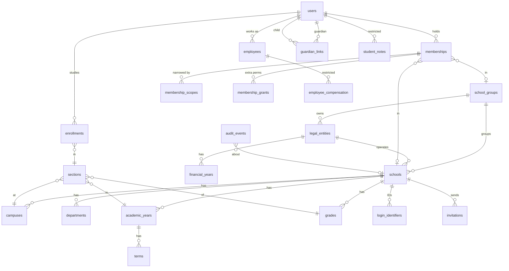

# Access: sign-in journeys, roles, data model and API

How VidyaNexus decides who can see and do what. The code is the source of truth: roles and permissions are in [`shared/roles.js`](../shared/roles.js), enforcement in [`server/access.js`](../server/access.js), and the rules are tested in [`test/access.test.js`](../test/access.test.js).

## Principles

1. **The entry card is navigation, not authorisation.** Picking "Corporate / School Administration" only opens that sign-in page and decides which workspace opens first.
2. **Permissions come from verified memberships, re-checked on every request.** A membership is a user + a school (or school group) + a role, optionally narrowed to sections. Suspending a membership takes effect on the next request.
3. **Seniority does not unlock confidential records.** Pay, health, counseling and safeguarding each need their own permission, which only roles made for that work have (or an explicit, reasoned grant).
4. **Administration workspaces need 2-step sign-in** (authenticator app). Parents, students, teachers and operational staff do not, so they are not locked out by a lost phone.
5. **Every school's records stay in that school.** Queries filter by the active workspace's school, and tenant-aware composite foreign keys stop rows from pointing across schools.

## Sign-in journeys

```
Home ──► one of three cards ──► /login/<card>
                                   │  email | Indian mobile | student/employee ID + school code
                                   ▼
                          password check (uniform failure, rate-limited)
                                   │
                     ┌─────────────┴──────────────┐
          one obvious, non-admin workspace     otherwise
                     │                            │
                     ▼                            ▼
               opens directly             workspace picker
                                                 │ admin workspace?
                                                 ▼
                                   2-step code (or first-time QR setup)
```

| Card | Who | Identifier | Workspaces offered first |
| --- | --- | --- | --- |
| Corporate / School Administration | Owners, group managers, principals, office, finance, HR, transport, auditors | Email or mobile | Administration (needs 2-step), staff self-service |
| Student / Parent | Students and guardians, separate accounts | Email, mobile, or admission number + school code | Student, parent |
| Teacher / Staff | Teachers and non-teaching employees | Email, mobile, or employee number + school code | Teacher, staff self-service |

People with several roles (for example a parent who is also the school accountant) see all their workspaces and switch from the profile menu. Recovery: "Forgot password?" queues a reset link (email delivery not yet connected), or a principal / campus admin issues a one-hour link from People & roles. New staff and parents join by invitation only.

## Role and permission matrix

Generated from `shared/roles.js`. Group roles sit on a school group and currently see group totals only; per-school drill-down for them is planned.

| Role | Workspace | `group.view` | `school.view` | `school.configure` | `members.view` | `members.invite` | `members.manage` | `audit.view` | `students.view` | `guardians.manage` | `staff.view` | `hr.compensation.view` | `health.view` | `counseling.view` | `safeguarding.view` | `learning.study` | `learning.teach` | `family.view` | `self.service` |
| --- | --- | --- | --- | --- | --- | --- | --- | --- | --- | --- | --- | --- | --- | --- | --- | --- | --- | --- | --- |
| Owner / trustee (group) | admin | ✓ | ✓ |  | ✓ |  |  | ✓ |  |  | ✓ |  |  |  |  |  |  |  |  |
| Group manager (group) | admin | ✓ | ✓ |  | ✓ |  |  |  |  |  | ✓ |  |  |  |  |  |  |  |  |
| Principal | admin |  | ✓ | ✓ | ✓ | ✓ | ✓ | ✓ | ✓ | ✓ | ✓ |  |  |  |  |  |  |  |  |
| Campus administrator | admin |  | ✓ | ✓ | ✓ | ✓ | ✓ | ✓ | ✓ | ✓ | ✓ |  |  |  |  |  |  |  |  |
| Admissions officer | admin |  | ✓ |  |  |  |  |  | ✓ | ✓ |  |  |  |  |  |  |  |  |  |
| Receptionist | admin |  | ✓ |  |  |  |  |  |  |  |  |  |  |  |  |  |  |  |  |
| Accountant | admin |  | ✓ |  |  |  |  |  | ✓ |  |  |  |  |  |  |  |  |  |  |
| Cashier | admin |  | ✓ |  |  |  |  |  |  |  |  |  |  |  |  |  |  |  |  |
| HR officer | admin |  | ✓ |  | ✓ |  |  |  |  |  | ✓ | ✓ |  |  |  |  |  |  |  |
| Payroll officer | admin |  | ✓ |  |  |  |  |  |  |  | ✓ | ✓ |  |  |  |  |  |  |  |
| Academic coordinator | admin |  | ✓ |  |  |  |  |  | ✓ |  | ✓ |  |  |  |  |  |  |  |  |
| Exam officer | admin |  | ✓ |  |  |  |  |  | ✓ |  |  |  |  |  |  |  |  |  |  |
| Transport manager | admin |  | ✓ |  |  |  |  |  |  |  |  |  |  |  |  |  |  |  |  |
| Safeguarding officer | admin |  | ✓ |  |  |  |  |  | ✓ |  |  |  |  |  | ✓ |  |  |  |  |
| Auditor | admin |  | ✓ |  |  |  |  | ✓ |  |  |  |  |  |  |  |  |  |  |  |
| Teacher | teacher |  |  |  |  |  |  |  |  |  |  |  |  |  |  |  | ✓ |  | ✓ |
| Counselor | worker |  |  |  |  |  |  |  |  |  |  |  |  | ✓ |  |  |  |  | ✓ |
| School nurse | worker |  |  |  |  |  |  |  |  |  |  |  | ✓ |  |  |  |  |  | ✓ |
| Librarian | worker |  |  |  |  |  |  |  |  |  |  |  |  |  |  |  |  |  | ✓ |
| Driver | worker |  |  |  |  |  |  |  |  |  |  |  |  |  |  |  |  |  | ✓ |
| Bus attendant | worker |  |  |  |  |  |  |  |  |  |  |  |  |  |  |  |  |  | ✓ |
| Hostel warden | worker |  |  |  |  |  |  |  |  |  |  |  |  |  |  |  |  |  | ✓ |
| Stores / inventory | worker |  |  |  |  |  |  |  |  |  |  |  |  |  |  |  |  |  | ✓ |
| Technician | worker |  |  |  |  |  |  |  |  |  |  |  |  |  |  |  |  |  | ✓ |
| Housekeeping | worker |  |  |  |  |  |  |  |  |  |  |  |  |  |  |  |  |  | ✓ |
| Security | worker |  |  |  |  |  |  |  |  |  |  |  |  |  |  |  |  |  | ✓ |
| Student | learner |  |  |  |  |  |  |  |  |  |  |  |  |  |  | ✓ |  |  |  |
| Parent / guardian | guardian |  |  |  |  |  |  |  |  |  |  |  |  |  |  |  |  | ✓ |  |

Section scopes: a teacher membership lists the sections it covers; teacher endpoints only reach students enrolled in those sections this year. Guardian access comes from `guardian_links` that are active **and** verified; each link also says whether that guardian may pick up the child, see fees, see health information and receive messages.

Who can invite whom: anyone with `members.invite` can invite school-level roles except students (who join through enrollment) and group roles (set up by the provider). Roles that can themselves invite people need an inviter with `members.manage`.

## Data model (identity and tenancy)



Existing learning tables (`homework`, `announcements`, `exams`, `results`, `awards`, `attendance`) now carry `school_id`, and homework, exams and announcements an optional `section_id` (empty means the whole school).

Money is stored in integer paise. Audit events are append-only (database triggers reject updates and deletes).

## API (new in this increment)

All under `/api`. Every route re-reads the session's active membership.

| Method and path | Permission | Notes |
| --- | --- | --- |
| `POST /auth/login` | – | `{portal, identifier, password, institution?}` |
| `POST /auth/logout`, `GET /me` | signed in | `/me` returns workspaces and the active one |
| `GET /auth/demo?portal=` | – | Demo accounts while default passwords are unchanged; off with `SHOW_DEMO_LOGINS=false` |
| `POST /workspaces/active` | own membership | `{membershipId, code?}`; admin roles need a 2-step code |
| `POST /mfa/setup`, `POST /mfa/enable` | signed in | QR + key, then confirm one code |
| `POST /auth/recover`, `POST /auth/reset` | – | Uniform answer; one-time 1-hour tokens |
| `GET /invitations/:token`, `POST /invitations/:token/accept` | token | Existing accounts confirm with their password |
| `GET/POST /admin/invitations`, `DELETE /admin/invitations/:id` | `members.invite` | |
| `GET /admin/members` | `members.view` | |
| `PATCH /admin/members/:id`, `POST /admin/members/:id/reset-password` | `members.manage` | Not on yourself; not on accounts shared with another school |
| `GET /admin/overview`, `GET /admin/setup` | `school.view` | |
| `POST /admin/sections` | `school.configure` | |
| `GET /admin/students` | `students.view` | |
| `GET /admin/staff` | `staff.view` | Pay only with `hr.compensation.view` (audited) |
| `GET /students/:id/notes/:kind` | `health.view` / `counseling.view` / `safeguarding.view` | Audited |
| `GET /admin/audit` | `audit.view` | Paged with `?before=` |
| `GET /group/overview` | `group.view` | Totals for the group's own schools |
| `GET /family/children`, `GET /family/children/:id` | `family.view` | Verified, active links only |
| `GET /staff/me` | `self.service` | Own details and own pay |

Existing student routes need `learning.study` and an active enrollment; teacher routes need `learning.teach` and are limited to the membership's sections.
