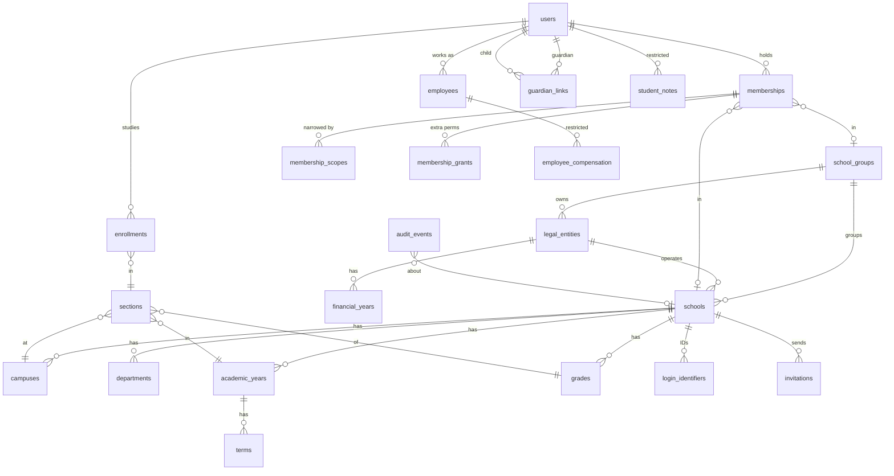

# Access: sign-in journeys, roles, data model and API

How VidyaNexus decides who can see and do what. The code is the source of truth: roles and permissions are in [`shared/roles.js`](../shared/roles.js), enforcement in [`server/access.js`](../server/access.js), and the rules are tested in [`test/access.test.js`](../test/access.test.js).

## Principles

1. **The entry card is navigation, not authorisation.** Picking "Corporate / School Administration" only opens that sign-in page and decides which workspace opens first.
2. **Permissions come from verified memberships, re-checked on every request.** A membership is a user + a school (or school group) + a role, optionally narrowed to sections. Suspending a membership takes effect on the next request.
3. **Seniority does not unlock confidential records.** Pay, health, counseling and safeguarding each need their own permission, which only roles made for that work have (or an explicit, reasoned grant).
4. **Administration workspaces need 2-step sign-in** (authenticator app). Parents, students, teachers and operational staff do not, so they are not locked out by a lost phone.
5. **Every school's records stay in that school.** Queries filter by the active workspace's school, and tenant-aware composite foreign keys stop rows from pointing across schools.

## Sign-in journeys

```
Home ──► one of three cards ──► /login/<card>
                                   │  email | Indian mobile | student/employee ID + school code
                                   ▼
                          password check (uniform failure, rate-limited)
                                   │
                     ┌─────────────┴──────────────┐
          one obvious, non-admin workspace     otherwise
                     │                            │
                     ▼                            ▼
               opens directly             workspace picker
                                                 │ admin workspace?
                                                 ▼
                                   2-step code (or first-time QR setup)
```

| Card | Who | Identifier | Workspaces offered first |
| --- | --- | --- | --- |
| Corporate / School Administration | Owners, group managers, principals, office, finance, HR, transport, auditors | Email or mobile | Administration (needs 2-step), staff self-service |
| Student / Parent | Students and guardians, separate accounts | Email, mobile, or admission number + school code | Student, parent |
| Teacher / Staff | Teachers and non-teaching employees | Email, mobile, or employee number + school code | Teacher, staff self-service |

People with several roles (for example a parent who is also the school accountant) see all their workspaces and switch from the profile menu. Recovery: "Forgot password?" queues a reset link (email delivery not yet connected), or a principal / campus admin issues a one-hour link from People & roles. New staff and parents join by invitation only.

## Role and permission matrix

Generated from `shared/roles.js` (each permission and the roles that hold it by default). 🔒 marks restricted permissions: no role gets them for being senior, only roles made for that work or an explicit grant with a reason. Group roles sit on a school group and currently see group totals only; per-school drill-down for them is planned.

Workspace kinds: owners, group managers, principals and office roles open the **administration** workspace (2-step sign-in); teachers the **teacher** workspace; counselors, nurses, librarians, drivers, attendants, wardens, stores, technicians, housekeeping and security the phone-friendly **staff** workspace; students the **student** app; guardians the **parent** view.

| Permission | What it allows | Roles that have it |
| --- | --- | --- |
| `group.view` | See the school group overview | Owner / trustee (group), Group manager (group) |
| `school.view` | See the school overview | Owner / trustee (group), Group manager (group), Principal, Campus administrator, Admissions officer, Receptionist, Accountant, Cashier, HR officer, Payroll officer, Academic coordinator, Exam officer, Transport manager, Safeguarding officer, Auditor |
| `school.configure` | Change school setup (campuses, years, classes) | Principal, Campus administrator |
| `members.view` | See people and their roles | Owner / trustee (group), Group manager (group), Principal, Campus administrator, HR officer |
| `members.invite` | Invite people and assign roles | Principal, Campus administrator |
| `members.manage` | Suspend or end memberships and reset passwords | Principal, Campus administrator |
| `audit.view` | Read the audit log | Owner / trustee (group), Principal, Campus administrator, Auditor |
| `students.view` | See the student register | Principal, Campus administrator, Admissions officer, Accountant, Academic coordinator, Exam officer, Safeguarding officer |
| `guardians.manage` | Link and verify guardians | Principal, Campus administrator, Admissions officer |
| `staff.view` | See the staff directory | Owner / trustee (group), Group manager (group), Principal, Campus administrator, HR officer, Payroll officer, Academic coordinator |
| `hr.compensation.view` 🔒 | See salaries and bank details | HR officer, Payroll officer |
| `health.view` 🔒 | See student health records | School nurse |
| `health.record` 🔒 | Record infirmary visits | School nurse |
| `counseling.view` 🔒 | See counseling notes | Counselor |
| `safeguarding.view` 🔒 | See and manage safeguarding cases | Safeguarding officer |
| `safeguarding.report` | Report a safeguarding concern | Principal, Campus administrator, Admissions officer, Receptionist, Accountant, Cashier, HR officer, Payroll officer, Academic coordinator, Exam officer, Transport manager, Safeguarding officer, Teacher, Counselor, School nurse, Librarian, Driver, Bus attendant, Hostel warden, Stores / inventory, Technician, Housekeeping, Security |
| `learning.study` | Use the student learning app | Student |
| `learning.teach` | Teach assigned classes (homework, exams, marks, attendance) | Teacher |
| `family.view` | See linked children's school information | Parent / guardian |
| `self.service` | Employee self-service (leave, payslips) | Principal, Campus administrator, Admissions officer, Receptionist, Accountant, Cashier, HR officer, Payroll officer, Academic coordinator, Exam officer, Transport manager, Safeguarding officer, Teacher, Counselor, School nurse, Librarian, Driver, Bus attendant, Hostel warden, Stores / inventory, Technician, Housekeeping, Security |
| `admissions.manage` | Handle enquiries, applications and enrollment | Principal, Campus administrator, Admissions officer, Receptionist |
| `fees.view` | See fee demands, payments and dues | Principal, Campus administrator, Admissions officer, Accountant, Cashier, Auditor |
| `fees.configure` | Set up fee heads, plans and demands | Accountant |
| `fees.collect` | Record payments and issue receipts | Accountant, Cashier |
| `fees.approve` | Approve concessions and refunds | Principal |
| `accounts.view` | See the books and reports | Principal, Accountant, Auditor |
| `accounts.post` | Prepare journals and lock periods | Accountant |
| `accounts.approve` | Approve manual journals | Principal |
| `leave.approve` | Approve staff leave | Principal, Campus administrator, HR officer, Academic coordinator |
| `payroll.prepare` 🔒 | Prepare payroll runs | HR officer, Payroll officer |
| `payroll.approve` 🔒 | Approve and release payroll | Principal |
| `transport.manage` | Manage routes, vehicles and allocations | Principal, Campus administrator, Transport manager |
| `transport.operate` | Run trips and record boarding | Transport manager, Driver, Bus attendant |
| `procurement.request` | Raise purchase requisitions | Principal, Campus administrator, Accountant, Stores / inventory |
| `procurement.approve` | Approve requisitions and supplier invoices | Principal |
| `procurement.manage` | Manage suppliers, orders, receipts and invoices | Accountant, Stores / inventory |
| `stores.manage` | Manage stock | Stores / inventory |
| `assets.manage` | Manage the asset register | Stores / inventory, Technician |
| `library.manage` | Run the library | Librarian |
| `visitors.manage` | Run reception, visitors and gate | Principal, Campus administrator, Receptionist, Security |
| `pickup.override` | Approve a pickup by someone not on the approved list | Principal, Campus administrator |
| `messages.send` | Draft and send school messages | Principal, Campus administrator |
| `messages.approve` | Approve bulk or sensitive messages | Principal |
| `helpdesk.raise` | Raise helpdesk requests | Principal, Campus administrator, Admissions officer, Receptionist, Accountant, Cashier, HR officer, Payroll officer, Academic coordinator, Exam officer, Transport manager, Safeguarding officer, Teacher, Counselor, School nurse, Librarian, Driver, Bus attendant, Hostel warden, Stores / inventory, Technician, Housekeeping, Security, Parent / guardian |
| `helpdesk.manage` | Handle helpdesk requests | Principal, Campus administrator, Receptionist |
| `helpdesk.grievance` 🔒 | Handle confidential grievances | Principal |

Section scopes: a teacher membership lists the sections it covers; teacher endpoints only reach students enrolled in those sections this year. Guardian access comes from `guardian_links` that are active **and** verified; each link also says whether that guardian may pick up the child, see fees, see health information and receive messages.

Who can invite whom: anyone with `members.invite` can invite school-level roles except students (who join through enrollment) and group roles (set up by the provider). Roles that can themselves invite people need an inviter with `members.manage`.

## Data model (identity and tenancy)



Existing learning tables (`homework`, `announcements`, `exams`, `results`, `awards`, `attendance`) now carry `school_id`, and homework, exams and announcements an optional `section_id` (empty means the whole school).

Money is stored in integer paise. Audit events are append-only (database triggers reject updates and deletes).

## API (new in this increment)

All under `/api`. Every route re-reads the session's active membership.

| Method and path | Permission | Notes |
| --- | --- | --- |
| `POST /auth/login` | – | `{portal, identifier, password, institution?}` |
| `POST /auth/logout`, `GET /me` | signed in | `/me` returns workspaces and the active one |
| `GET /auth/demo?portal=` | – | Demo accounts while default passwords are unchanged; off with `SHOW_DEMO_LOGINS=false` |
| `POST /workspaces/active` | own membership | `{membershipId, code?}`; admin roles need a 2-step code |
| `POST /mfa/setup`, `POST /mfa/enable` | signed in | QR + key, then confirm one code |
| `POST /auth/recover`, `POST /auth/reset` | – | Uniform answer; one-time 1-hour tokens |
| `GET /invitations/:token`, `POST /invitations/:token/accept` | token | Existing accounts confirm with their password |
| `GET/POST /admin/invitations`, `DELETE /admin/invitations/:id` | `members.invite` | |
| `GET /admin/members` | `members.view` | |
| `PATCH /admin/members/:id`, `POST /admin/members/:id/reset-password` | `members.manage` | Not on yourself; not on accounts shared with another school |
| `GET /admin/overview`, `GET /admin/setup` | `school.view` | |
| `POST /admin/sections` | `school.configure` | |
| `GET /admin/students` | `students.view` | |
| `GET /admin/staff` | `staff.view` | Pay only with `hr.compensation.view` (audited) |
| `GET /students/:id/notes/:kind` | `health.view` / `counseling.view` / `safeguarding.view` | Audited |
| `GET /admin/audit` | `audit.view` | Paged with `?before=` |
| `GET /group/overview` | `group.view` | Totals for the group's own schools |
| `GET /family/children`, `GET /family/children/:id` | `family.view` | Verified, active links only |
| `GET /staff/me` | `self.service` | Own details and own pay |

Existing student routes need `learning.study` and an active enrollment; teacher routes need `learning.teach` and are limited to the membership's sections.

## API: office modules (release 2)

All under `/api`, all scoped to the active workspace's school. Money is integer paise. Records that a stale screen could overwrite (applications, journals, payroll runs and similar) take the `version` the screen loaded and refuse an older one with `409 conflict.stale`; payments take an `idempotencyKey`, so submitting twice returns the first receipt.

| Area | Paths | Permission |
| --- | --- | --- |
| Admissions | `/admissions`, `/admissions/:id`, `…/status`, `…/enroll` | `admissions.manage` |
| Fees (office) | `/fees/overview`, `/fees/students[/:id]`, `/fees/payments`, `/fees/dues`, `/fees/setup`, `/fees/approvals`, `/fees/exceptions`, `/fees/receipts/:id` | `fees.view` to read; `fees.configure` for heads, plans, demands and generation; `fees.collect` for payments, bounces, reconciliation, refund requests and reminders; `fees.approve` for concessions and refunds (never the person who asked) |
| Fees (parents) | `/family/fees`, `/family/fees/checkout`, `/family/fees/sandbox-pay`, `/family/receipts/:id` | `family.view` and a verified link that allows fees |
| Payment gateway | `POST /payments/webhook` | Gateway signature (HMAC); duplicates, forgeries and out-of-order events change nothing |
| Accounts | `/accounts/summary`, `/accounts/chart`, `/accounts/trial-balance`, `/accounts/journals`, `/accounts/drafts`, `/accounts/locks` | `accounts.view` to read; `accounts.post` to prepare journals and lock months; `accounts.approve` to approve (not your own) |
| Leave | `/me/leave` (apply, cancel), `/hr/leave` (decide) | `self.service`; `leave.approve` (not your own) |
| Payroll | `/hr/payroll`, `/hr/payroll/runs/:id` (recompute, approve, paid, cancel, `bank.csv`), `/hr/payroll/rules/:id`, `/me/payslips` | `payroll.prepare` 🔒; `payroll.approve` 🔒 (sees totals, not individual pay); `self.service` for your own payslips |
| Transport | `/transport` (routes, stops, vehicles, allocations), `/trips/today`, `/trips` (start, events, gps, close), `/family/transport` | `transport.manage`; `transport.operate` (own routes only); `family.view` |
| Purchasing, stores, assets | `/procurement` (vendors, items, requisitions, orders, receipts, invoices), `/stores/moves`, `/stores/issue`, `/stores/adjust`, `/assets` | `procurement.request`, `procurement.approve` (not your own), `procurement.manage`, `stores.manage`, `assets.manage` |
| Library | `/library` (books, issue, return, fines), `/me/library` | `library.manage`; borrowers and guardians see their own loans |
| Reception | `/reception` (visitors, check-out, pickups, release, refuse) | `visitors.manage`; an override needs `pickup.override` and a reason |
| Health | `/infirmary`, `/infirmary/students/:id`, `/infirmary/visits`, `/family/health` | `health.view` 🔒 / `health.record` 🔒; guardians whose link allows health information |
| Safeguarding | `/safeguarding/reports`, `/safeguarding/mine`, `/safeguarding/cases[/:id]`, `…/notes` | `safeguarding.report` to report and see your own reports; `safeguarding.view` 🔒 for cases |
| Messages | `/messages`, `/messages/preview`, `/messages/:id/decide` | `messages.send`; `messages.approve` for bulk (not your own) |
| Helpdesk | `/helpdesk/mine`, `/helpdesk/tickets[/:id]`, `…/comments` | `helpdesk.raise`; `helpdesk.manage`; `helpdesk.grievance` 🔒 for confidential grievances |
| Inbox and approvals | `/inbox`, `/inbox/count`, `/inbox/read`, `/approvals` | Signed in; `/approvals` lists only what this person may decide, leaving out their own requests |
| Lookups | `/lookup/students`, `/lookup/students/:id/guardians` | Any desk permission (fees, admissions, transport, library, reception, health, safeguarding) |
